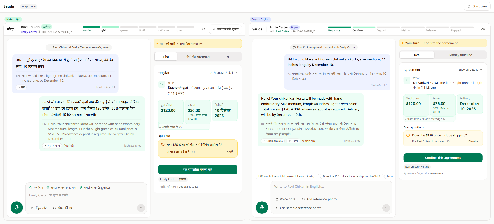
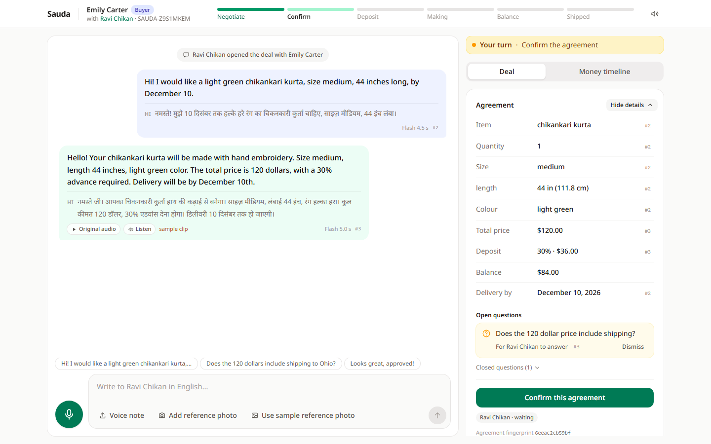
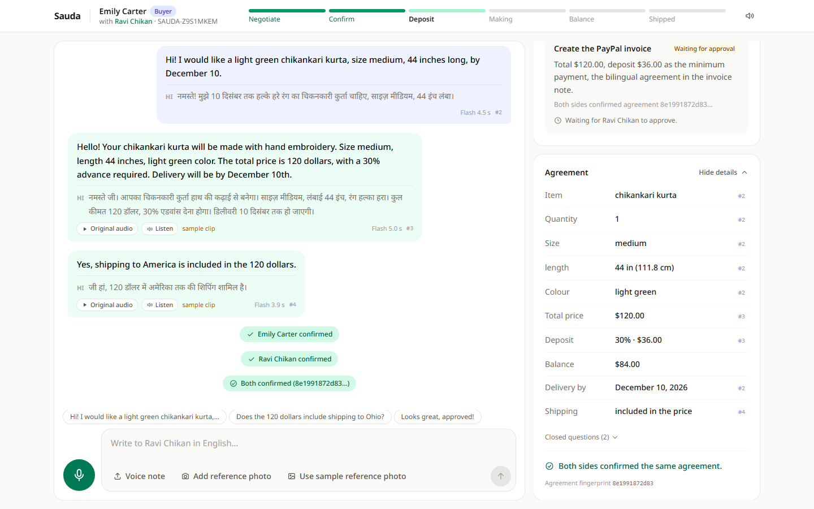
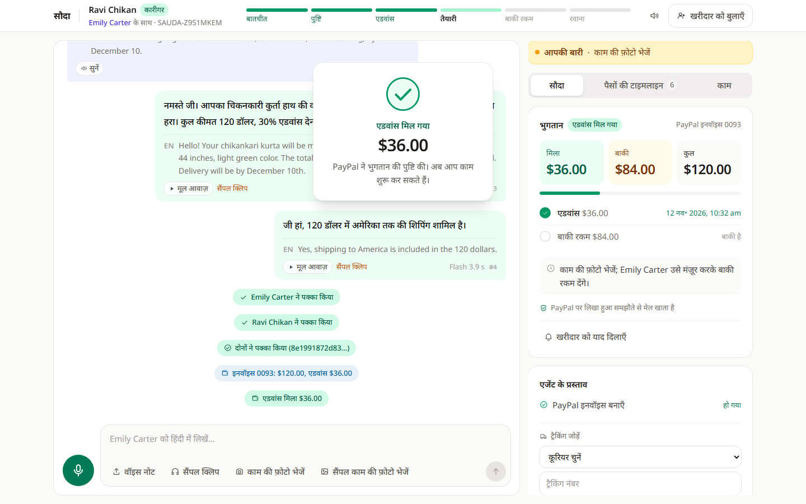
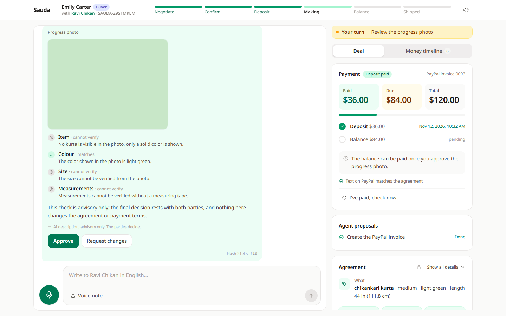
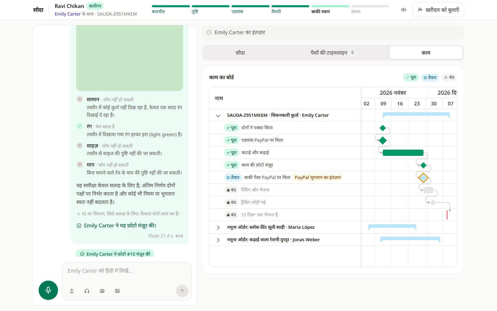
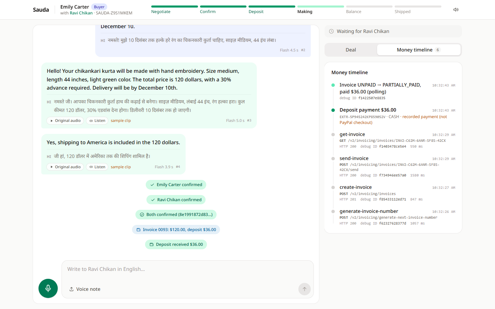
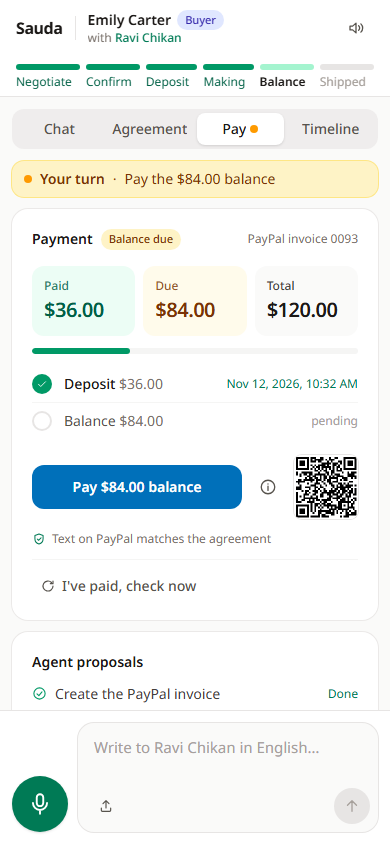
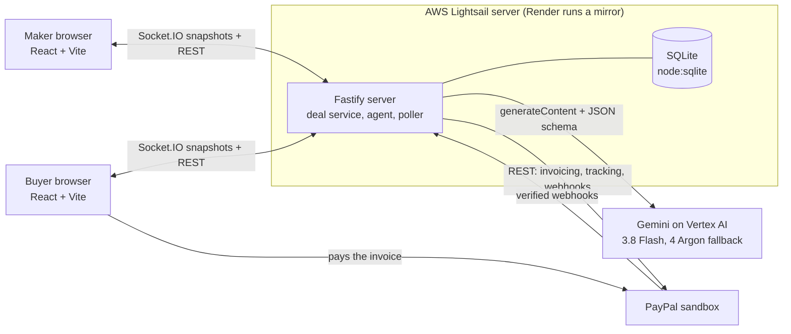

# Sauda

**A live deal room where a Hindi-speaking maker and an English-speaking buyer agree a custom order in their own languages, and PayPal Invoicing runs the deposit, the balance and the shipment.** Any pair of seven languages works: Hindi, English, Spanish, French, Brazilian Portuguese, German and Japanese.

- **Hosted demo:** https://184-193-2-247.sslip.io (PayPal sandbox only, no real money), on AWS. Backup mirror on Render: https://sauda-95sg.onrender.com
- **Video:** VIDEO_URL
- **Code:** https://github.com/krushnasalunke215-lang/Sauda (MIT)



## Try it in 2 minutes

1. Open https://184-193-2-247.sslip.io/demo. It creates a fresh deal and shows the maker (Hindi) on the left and the buyer (English) on the right, in judge mode, which adds the model, the latency and the message number to each turn.
2. On the buyer side, type in English or tap one of the sample messages above the input box.
3. On the maker side, open the sample clips menu (the headphones button, **सैंपल क्लिप**; the maker's screen is in Hindi) and press the first clip, the full order spoken by a real Hindi speaker. Gemini transcribes and translates it, and the agreement fills in on both sides. The AI then asks whether the price includes shipping; press the shipping clip to answer it.
4. Press **Confirm this agreement** on the buyer side and **यह समझौता पक्का करें** on the maker side, then **मंज़ूर करें** (Approve) on the maker's invoice card. A real sandbox invoice is created and sent.
5. On the buyer side, follow the amber **Your turn** line: press **Pay $36.00 deposit** and pay with the sandbox buyer login from the Devpost testing instructions. Keep the pre-filled 36.00. Within about 10 seconds the maker sees **एडवांस मिल गया** (Deposit received) and the buyer sees "Deposit paid". If the PayPal tab keeps loading after "Thank you for using PayPal", close it: the room checks PayPal itself.

## The problem and who it is for

Makers who take custom orders, such as tailors, embroiderers and jewellers, often have buyers abroad who speak another language. A custom order needs back-and-forth on size, colour, deadline, price and deposit. Across a language gap that work goes to a middleman, or the misunderstanding turns into a return or a dispute.

- Most shoppers want to buy in their own language: in a CSA Research survey of 29 countries, 76% preferred product information in their language and 40% never bought from sites in other languages ([CSA Research, 2020](https://csa-research.com/l/media/Consumers-Prefer-their-Own-Language)).
- India alone counts 64.66 lakh (about 6.5 million) handicraft artisans ([PIB background note](https://static.pib.gov.in/WriteReadData/specificdocs/documents/2025/dec/doc2025129724401.pdf)).
- PayPal in India is a cross-border service for selling abroad, not a domestic wallet ([TechCrunch](https://techcrunch.com/2021/02/04/paypal-is-shutting-down-domestic-payments-business-in-india/)).

The demo pair is Ravi, a chikankari tailor in Lucknow who speaks Hindi, and Emily, a buyer in Ohio who speaks English. The same room works between any two of Hindi, English, Spanish, French, Brazilian Portuguese, German and Japanese: the whole interface, the invoice text, dates and units follow each side's language. A Japanese maker and a French buyer run a full deal in the end-to-end tests.

## What it does

- **Two private links, one room.** Each side opens its own link and talks in its own language (Hindi, English, Spanish, French, Brazilian Portuguese, German or Japanese), by push-to-talk, a voice note, a sample clip or typing. Every turn is shown to the other side translated, with the original underneath, and can be read aloud in a voice that matches the speaker. A "Your turn" line names each side's next step, and colour marks who is who (maker green, buyer indigo) and what needs doing (amber).
- **An agreement that writes itself, with sources.** Item, size, length, colour, price, deposit, delivery date and shipping fill in as the parties talk. Each term links to the message it came from. When something is unclear, such as whether the price includes shipping, the AI asks the right person.

  

- **Both sides confirm the same terms.** Each confirmation is tied to a SHA-256 fingerprint of the agreement. Only when both sides have confirmed the same fingerprint does the agent propose the invoice, and only the maker can approve it.

  

- **PayPal runs the money.** One PayPal invoice carries the bilingual agreement. The deposit (30%) is the minimum payment, so the buyer pays it first. The maker sees "Deposit received" in Hindi on screen. After the buyer approves a progress photo, the balance is paid on the same invoice, and the maker's spoken tracking number becomes PayPal tracking. The payments in these screenshots were recorded through the API; the video shows a real sandbox checkout.

  

  

- **The maker's production board and a money timeline.** A Bryntum Gantt board shows each order's steps, with "deposit paid" and "balance paid" as gates: work after a gate stays locked until PayPal confirms that payment. The money timeline lists every PayPal call, payment and webhook with its PayPal debug ID.

  

  

On a phone the buyer gets tabs and a composer that stays in view:



## How PayPal is used

Everything runs against `https://api-m.sandbox.paypal.com`. The REST client refuses any other origin.

| Capability | Endpoint | File | Why |
|---|---|---|---|
| OAuth 2.0 client credentials, token cached until 60 s before expiry | `POST /v1/oauth2/token` | [server/paypal/client.ts](server/paypal/client.ts) | One token for all calls; every call records its `paypal-debug-id` for the money timeline. |
| Next invoice number | `POST /v2/invoicing/generate-next-invoice-number` | [server/paypal/invoices.ts](server/paypal/invoices.ts) | Invoice numbers come from PayPal, not from Sauda. |
| Create the invoice with a deposit | `POST /v2/invoicing/invoices` with `configuration.partial_payment` (`allow_partial_payment: true`, `minimum_amount_due` = the deposit) | [server/paypal/invoices.ts](server/paypal/invoices.ts), [server/domain/agreement-text.ts](server/domain/agreement-text.ts) | One invoice covers deposit and balance. The note, terms, item and reference hold the bilingual agreement and its SHA-256 hash. |
| Send without PayPal emails | `POST /v2/invoicing/invoices/{id}/send` with `send_to_recipient: false` | [server/paypal/invoices.ts](server/paypal/invoices.ts) | The pay link and a QR code appear in the room instead of an email. |
| Read the invoice | `GET /v2/invoicing/invoices/{id}` | [server/paypal/sync.ts](server/paypal/sync.ts), [server/paypal/poller.ts](server/paypal/poller.ts) | The source of truth for status, paid and due amounts and the payment transactions. Open invoices are polled every 10 s. |
| Verify webhooks | `POST /v1/notifications/verify-webhook-signature` | [server/paypal/webhooks.ts](server/paypal/webhooks.ts), [server/routes/paypal.ts](server/routes/paypal.ts) | Only verified events count. Each is deduplicated by event id and only triggers a fresh `GET` of the invoice, because event bodies can arrive out of order. |
| Register the webhook | `GET` and `POST /v1/notifications/webhooks` | [server/paypal/webhooks.ts](server/paypal/webhooks.ts) | At boot the server finds or creates its webhook for `INVOICING.INVOICE.PAID`, `UPDATED` and `CANCELLED`. |
| Add tracking | `POST /v1/shipping/trackers-batch`, then `GET /v1/shipping/trackers/{transaction_id}-{tracking_number}` | [server/paypal/tracking.ts](server/paypal/tracking.ts) | Tracking goes on every PayPal payment transaction of the invoice and is read back to show SHIPPED. |
| Payment reminder through the Agent Toolkit | `send_invoice_reminder` from `@paypal/agent-toolkit` (local, sandbox) | [server/paypal/toolkit.ts](server/paypal/toolkit.ts) | The maker's "Remind buyer" card. |

Every write carries a `PayPal-Request-Id`. The create and send keys come from the agreement hash, so a retry cannot create a second invoice.

Invoice lifecycle in the demo: `UNPAID` → `PARTIALLY_PAID` (deposit) → `PAID` (balance) → tracking `SHIPPED`.

## How AI is used

All model calls go to Gemini on Vertex AI (express mode) through the Google Gen AI SDK. AI output is advice: deterministic code owns money, dates, units, hashes and every PayPal guard.

| Task | Model | Guardrail in code |
|---|---|---|
| Interpret a turn (voice or text): transcript, language, translation, agreement changes with source, clarifying questions, intents | `gemini-3.8-flash` at thinking level LOW. If it fails or has not answered after 8 s, `gemini-4-argon` is asked too while Flash keeps running; the first valid answer wins, within 38 s in total | One call with `responseJsonSchema`, then Ajv validation; an invalid answer counts as a failure. Money is integer cents; dates and units are parsed in code. [server/ai/gemini.ts](server/ai/gemini.ts), [server/ai/interpret.ts](server/ai/interpret.ts), [server/ai/schemas.ts](server/ai/schemas.ts) |
| Describe the buyer's reference photo to the maker; check the maker's progress photo against the agreed terms | Same fast model and fallback | Advisory only: the buyer approves or rejects the photo, and the "Pay $84.00 balance" button appears only after the buyer approves. [server/ai/vision.ts](server/ai/vision.ts) |
| Tracking and reminder intents ("DHL, number 4567891234") | Same call as the turn | An intent only becomes an approval card. The maker approves it, and code checks the carrier, the number and the invoice state first. [server/agent/proposals.ts](server/agent/proposals.ts), [server/agent/approvals.ts](server/agent/approvals.ts) |
| Read a message aloud in a voice that matches its speaker (Aoede for the buyer, Umbriel for the maker), in all seven languages | `gemini-3.8-flash-tts` | The text is read as written, cut at 600 characters, with a 20 s timeout; each clip is cached per message. If the Gemini voice fails or has not started within 10 s, the browser's own voice reads the text. [server/ai/tts.ts](server/ai/tts.ts), [client/src/audio/speech.ts](client/src/audio/speech.ts) |

Every model attempt, including fallbacks and speech, first reserves a call from a daily budget (`AI_DAILY_CALL_LIMIT`, default 500) in [server/ai/budget.ts](server/ai/budget.ts).

**Latency.** In the Day-0 test on the author's 23 s Hindi clip, Flash at LOW answered in 4.2 to 5.3 s and Argon in 6.2 to 8.6 s, both with every term right. Flash had rare long outliers (one call took 113 s), which is why Argon is asked after 8 s. Flash keeps running meanwhile, because when Vertex AI is busy Flash may still answer at 10 to 25 s while Argon returns 429 (quota). On the hosted demo on Nov 11, Flash answered text turns in 3 to 4 s and the Hindi clips and photo checks in 3.5 to 14 s. In judge mode each message shows which model answered and how long it took.

**AI tools used to build Sauda:** Kiro, as the coding agent.

## Architecture



The server keeps each deal as one JSON document, changes it only through a per-deal lock, and after every change sends each side a snapshot filtered for its role.

## Trust and correctness

- **Two-sided confirmation of the same terms.** A confirmation stores the SHA-256 hash of the canonical agreement. If the terms change afterwards, the hash no longer matches and both sides must confirm again. The hash is printed in the invoice note, and its first 16 characters in the invoice reference.
- **No invoice before both confirm.** The agent can only propose the invoice. Approving it re-checks that both sides confirmed the current hash, that required terms are present and valid, and that the texts fit PayPal's limits ([server/agent/proposals.ts](server/agent/proposals.ts)).
- **Deterministic money.** Prices, deposits and balances are integer cents and are formatted only at the edge ([server/domain/money.ts](server/domain/money.ts)).
- **PayPal's text limits in UTF-8 bytes.** Hindi (Devanagari) and Japanese take about three bytes per character, so the note, terms, item and reference are checked in bytes before anything is sent ([server/domain/agreement-text.ts](server/domain/agreement-text.ts)). A unit test builds a long agreement for all 42 ordered language pairs and checks that each fits.
- **Idempotent writes.** Every PayPal write has a `PayPal-Request-Id`.
- **Verified, deduplicated webhooks.** Signatures are verified with PayPal, each event id counts once, and the invoice is read again instead of trusting the event body. Polling covers a late or missing webhook.
- **Limits for a public demo.** Per-IP rate limits on deal creation, turns, photos and approvals ([server/app.ts](server/app.ts)), per-deal caps of 200 messages and 20 photos ([server/deals/service.ts](server/deals/service.ts)), and the daily AI call budget ([server/ai/budget.ts](server/ai/budget.ts)).
- **Sandbox only.** There is no setting for the live API, and secrets come only from environment variables.

## Built during the hackathon

All code was written for this hackathon, from Fri Nov 6 to Thu Nov 12, 2026 (IST), after a Day-0 test of the PayPal and Gemini calls. The commit history (`git log --reverse`) shows it:

| Date (IST) | Commit | What |
|---|---|---|
| Fri Nov 6, 20:48 | [8d78963](https://github.com/krushnasalunke215-lang/Sauda/commit/8d78963) | `.gitignore` |
| Fri Nov 6, 23:22 | [76775fd](https://github.com/krushnasalunke215-lang/Sauda/commit/76775fd) | Foundation and the text deal room |
| Sat Nov 7, 01:01 | [e8927fc](https://github.com/krushnasalunke215-lang/Sauda/commit/e8927fc) | Push-to-talk voice, speech playback and photo understanding |
| Sat Nov 7, 11:58 | [ff72431](https://github.com/krushnasalunke215-lang/Sauda/commit/ff72431) | PayPal invoicing lifecycle, webhooks, tracking and the money timeline |
| Sat Nov 7, 15:41 | [e2e0bc5](https://github.com/krushnasalunke215-lang/Sauda/commit/e2e0bc5) | Clean, minimal UI redesign with written design rules |
| Sat Nov 7, 19:35 | [4893d5c](https://github.com/krushnasalunke215-lang/Sauda/commit/4893d5c) | GitHub's initial commit with the MIT LICENSE |
| Sat Nov 7, 20:54 | [adc3c7d](https://github.com/krushnasalunke215-lang/Sauda/commit/adc3c7d) | Technical labels only in judge mode |
| Sat Nov 7, 21:27 | [92ad15f](https://github.com/krushnasalunke215-lang/Sauda/commit/92ad15f) | Rate limits, AI budget, judge-mode `/demo`, mobile buyer tabs and the Render blueprint |
| Sat Nov 7, 21:30 | [88d151a](https://github.com/krushnasalunke215-lang/Sauda/commit/88d151a) | Merge of the GitHub repo's initial commit |
| Sun Nov 8, 10:48 | [d00882b](https://github.com/krushnasalunke215-lang/Sauda/commit/d00882b) | The author's Hindi sample clips and a Free-plan Render blueprint |
| Sun Nov 8, 12:11 | [5321be6](https://github.com/krushnasalunke215-lang/Sauda/commit/5321be6) | Judge mode, hardening and the Render deployment |
| Sun Nov 8, 16:16 | [490eb90](https://github.com/krushnasalunke215-lang/Sauda/commit/490eb90) | Production board with payment gates (built-in board) |
| Sun Nov 8, 22:13 | [3439ff1](https://github.com/krushnasalunke215-lang/Sauda/commit/3439ff1) | Bryntum Gantt production board |
| Mon Nov 9, 00:33 | [908eada](https://github.com/krushnasalunke215-lang/Sauda/commit/908eada) | UI polish: voice first, live agreement, payment moment, named progress |
| Mon Nov 9, 10:42 | [673ecce](https://github.com/krushnasalunke215-lang/Sauda/commit/673ecce) | Sample reference and progress photos |
| Tue Nov 10, 20:25 | [565e451](https://github.com/krushnasalunke215-lang/Sauda/commit/565e451) | Test: log the Gemini fallback share of each flow run |
| Tue Nov 10, 21:14 | [83d3a9f](https://github.com/krushnasalunke215-lang/Sauda/commit/83d3a9f) | Fix: keep a slow Flash call running while the fallback model is asked |
| Wed Nov 11, 15:50 | [4f6d418](https://github.com/krushnasalunke215-lang/Sauda/commit/4f6d418) | Gemini voices for spoken playback, matched to the speaker |

This README and its screenshots followed on Wed Nov 11, and the move of the hosted demo to AWS and the language and colour refresh (French, Portuguese, German and Japanese, the "Your turn" line, colour-coded roles and states) on Thu Nov 12.

## Run locally

You need:

- Node 24.11 or newer.
- A PayPal sandbox REST app with the Invoicing feature enabled, linked to a **US business** sandbox account (partial payments are not available to India-registered accounts), and a US personal sandbox account as the buyer.
- A Gemini API key: a Vertex AI key in express mode (`GEMINI_BACKEND=vertex`) or an AI Studio key (`GEMINI_BACKEND=aistudio`).

```sh
npm ci
cp .env.example .env     # fill in the values; .env is git-ignored
npm run dev              # server on http://localhost:8787 plus Vite's dev server
npm test                 # unit tests (Vitest)
npm run e2e              # end-to-end tests (Playwright); real Gemini and PayPal sandbox calls
```

`npm run build` followed by `npm start` serves the built client from the server on port 8787. Nothing needs seeding: the sample clips and photos ship in `samples/`, and `/demo` creates a fresh deal.

**The production board.** Sauda uses [Bryntum Gantt Community](https://www.npmjs.com/package/@bryntum/gantt-community) 8.0.0 (MIT, public npm registry), installed by `npm run bryntum:install` and not saved in `package.json`. The AWS and Render builds run that command before the build. Without it, a simpler built-in board appears with the same rows and gates, and everything else works the same. No Bryntum account or trial is needed.

**Webhooks locally.** Set `PUBLIC_BASE_URL` to a public https URL (for example an ngrok tunnel) and the server registers its webhook at boot. Without one, polling picks up every payment.

## Deploy on Render

In the Render dashboard choose New → Blueprint, pick this repo (Render reads `render.yaml`), enter the five secrets (`PAYPAL_CLIENT_ID`, `PAYPAL_CLIENT_SECRET`, `PAYPAL_MERCHANT_EMAIL`, `PAYPAL_BUYER_EMAIL`, `GEMINI_API_KEY`) and apply. The service builds with `npm ci && npm run bryntum:install && npm run build`, starts with `npm start` and is health-checked at `/healthz`. At boot the server finds or registers its PayPal webhook at `<RENDER_EXTERNAL_URL>/api/paypal/webhook`.

The Render service is the backup mirror of the hosted demo, at https://sauda-95sg.onrender.com, and redeploys on every push to `main`. It runs on Render's Free instance type, which has no persistent disk. The first visit after about 15 idle minutes can take up to a minute, and deals reset when the instance restarts or spins down, so run a deal from start to finish in one sitting. `render.starter.yaml` is the same service on the Starter plan with a 1 GB disk at `/var/data`; copy it over `render.yaml` and push to keep deals across restarts with the same URL.

## Hosting on AWS Lightsail

The hosted demo, https://184-193-2-247.sslip.io, runs on one AWS Lightsail instance (Ubuntu 24.04, 2 GB RAM, us-east-1, static IP 184.193.2.247). [sslip.io](https://sslip.io) resolves that name to the IP, and Caddy serves it over HTTPS with a Let's Encrypt certificate, which the microphone and PayPal webhooks need. The host files are in [deploy/aws](deploy/aws):

- [sauda.service](deploy/aws/sauda.service): the systemd unit. It runs the server as the `sauda` user on port 8787 and starts it again after a crash or a reboot. The SQLite database and the media are in `/var/lib/sauda` on the instance's disk, so deals survive restarts. The five secrets are in `/etc/sauda/sauda.env`, readable only by `sauda`.
- [Caddyfile](deploy/aws/Caddyfile): HTTPS on port 443, proxied to the server.
- [redeploy.sh](deploy/aws/redeploy.sh), installed as `sauda-redeploy`: builds a commit in its own folder under `/opt/sauda/releases` while the current version keeps serving, switches `/opt/sauda/current` to it, restarts the service and waits until `/healthz` reports that commit. It also installs the unit and the Caddyfile from that commit.

To deploy a pushed commit, run `sudo sauda-redeploy` on the instance (`ssh ubuntu@184.193.2.247` with the instance's key), or `sudo sauda-redeploy <commit>` to roll back. Logs: `journalctl -u sauda`. At boot the server finds or registers its own PayPal webhook for its URL, next to the Render mirror's, and each verifies its own deliveries.

One-time setup, already done on the instance: Node 24.11.1 in `/opt/node`, Caddy from its apt repository, a 2 GB swap file, BBR congestion control, the `sauda` system user, `/etc/sauda/sauda.env`, then `sudo sauda-redeploy`. The Lightsail firewall allows TCP 22, 80 and 443.

## Limitations and roadmap

- **One maker account.** All invoices come from one sandbox business account. Onboarding many makers needs PayPal's partner onboarding.
- **No production authentication.** A room is protected by the secret token in its link, which is enough for a demo but not for real use.
- **No disputes or refunds** yet. The confirmed, hashed agreement on the invoice is a natural piece of dispute evidence; using it is on the roadmap.
- **USD only, no INR settlement.** The sandbox merchant is a US business. Real Indian makers would rely on PayPal India's cross-border receiving, which was not tested here.
- **Gemini capacity.** When Vertex AI is busy, Flash can take longer than 30 s and the fallback can return 429 (quota). A turn with no valid answer after 38 s shows a Retry button.
- **Machine-drafted translations.** The UI text beyond Hindi, English and Spanish was drafted with Gemini and checked by back-translation, a model judge and a spot check, not by native speakers.
- **Hindi-only sample clips.** The recorded sample clips are in Hindi. In the other languages, speak or type.
- **Push-to-talk, not streaming.** Each turn is one clip and one model call, about 5 to 8 s. Live speech-to-speech translation (Gemini Live) is a possible upgrade; it was not tested with Hindi.
- **Sandbox checkout can hang** on "Thank you for using PayPal". The room does not depend on the redirect: it polls the invoice and shows the payment anyway.
- **No invoice attachments.** The Invoicing API cannot upload them, so photos stay in the room and the agreement goes in the invoice text fields.
- **Reminders are slow in the sandbox** (one took about 70 s) and the Agent Toolkit returns no debug ID, so the timeline shows "—" for them.
- **Tracking needs a PayPal payment.** Payments recorded by hand (as the automated tests do) have no PayPal transaction, so the tracking card says so instead of adding tracking.
- **One small server.** The hosted demo is a single 2 GB instance in us-east-1 with no CDN, so far from the US the first load and the 2 MB production board take a few seconds longer. On the Render mirror, deals reset when the instance restarts, and the first visit after idle is slow.

## License

[MIT](LICENSE). Bryntum Gantt Community is MIT-licensed by Bryntum and is installed separately; it is not part of this repository.
